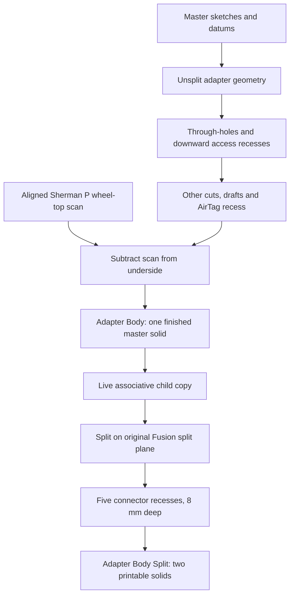

# CAD rebuild guide

## Purpose and authoritative inputs

Reproduce the accepted Onshape geometry from the original Fusion model in another CAD system. This guide records what was extracted, which features were reproduced, what changed at the user's request, and how the finished parent/child relationship works.

The source was the active Fusion document `Surron Seat Adapter v3 v2`, in project/folder `Sherman P`. It had 200 timeline entries. Relevant components were `AdapterBody` and `AdapterBodySplit`; the source assembly also contained a seat, latch, saddlebag mount, old trunk branches, and reference wheel geometry that were outside the requested rebuild.

Use [recipe.json](../cad-rebuild/recipe.json) as the machine-readable specification and [FEATURE-RECIPE.md](FEATURE-RECIPE.md) as its table of operations. Every source marker is indexed in [FUSION-TIMELINE.md](FUSION-TIMELINE.md). Timeline indices in this documentation are **zero-based**.

The saved final design takes precedence over the original source where the user explicitly changed scope: no fillets, no old reference-wheel cut, a live printing child, five connector recesses, corrected screw access, and a later authorized Sherman P scan imprint.

## Final model structure



The master retains its own editable history. The child references the finished master and adds print-specific geometry. Onshape's native Derived feature supplies this association. In another CAD system, use an equivalent linked body, external reference, dependency graph, or a child model generated from the same master body function. A plain detached copy does not preserve the intended update behavior.

## Units and coordinate frames

| Data | Lengths | Angles |
|---|---|---|
| Raw Fusion extracts | centimeters | radians for numeric parameter values |
| Portable recipe and this guide | millimeters | degrees |
| Onshape convenience tools used during the session | inches | degrees |
| Raw Onshape geometry and FeatureScript output | meters unless explicitly unit-tagged | explicit units |
| Original and aligned STL files | unitless numbers interpreted as millimeters for this project | n/a |

Conversions: `mm = Fusion_cm * 10`, `inches = Fusion_cm / 2.54`, `meters = mm / 1000`, `degrees = radians * 180/pi`. Preserve the original expressions separately from numerical conversions. `Gap` is a Fusion user parameter with expression `-0.2 mm`; its numeric Fusion API value is `-0.02` centimeters.

Global X is the adapter width, Y runs along the adapter with the screen/front cutout toward positive Y, and Z is up. The center mirror plane is global `X=0`.

A saved sketch point `(u,v,w)` is **not** automatically a global point. Transform it as:

```text
N = cross(sketchXAxis, sketchYAxis)
globalPoint = sketchOrigin + u*sketchXAxis + v*sketchYAxis + w*N
```

All terms must use the same length unit. Directions are unitless. The rear sketch contains nonzero sketch-space Z, about `-263.445982 mm`; dropping that coordinate moves its plane to the wrong location. Its source X axis is global +X, source Y axis is global -Z, and its normal is global +Y.

Onshape assigned canonical in-plane directions to several imported construction planes. Merely copying the plane normal did not preserve Fusion's sketch orientation. Seven sketches needed coordinate conversion into Onshape's actual frame. When porting, either construct the requested frame exactly or transform every curve point into the target sketch's actual frame. Do not patch this by guessing signs.

## Geometry and profile selection

The first extraction saved 18 sketches and 233 source curves, with dimensions and frames. This includes three split-variant sketches that no longer exist in the master. Their geometry remains in the portable recipe because it is needed to reconstruct the child.

Most curves are exact lines, circles, and arcs. One `RearSeatNotchSketch` ellipse was initially sampled, then replaced with an exact native ellipse. In its original Fusion sketch frame it has center `(-14.5, 196.70896933768436)` mm, major radius `3.5` mm, minor radius `3.4895137853640384` mm, and major axis +U. The portable recipe contains these exact parameters, not the temporary segments.

An extrusion often selects only some regions of a sketch. The profile-loop extraction saves **37 selected profiles across 20 extrusion features**, including outer/inner loops, analytic curve data, areas, and centroids. Use those loops to identify or build the intended regions. A bounding-box match was useful during migration, but Fusion's boxes for arcs were sometimes loose while Onshape's were tight. Boxes alone are not a reliable cross-kernel profile identifier.

If building CSG rather than native sketch features, construct a planar face from each selected outer loop minus its inner loops, merge adjacent selected regions where appropriate, and extrude that face. The curve list can contain reversed edges and collinear segments. Order/orient a loop by endpoint connectivity; do not assume every curve is already in traversal order.

The saved original dimensions and 149 model parameters preserve numerical values and expressions. The complete original sketch constraint graph and every constraint-to-entity association were **not** exported. Geometry can be reproduced from the saved coordinates; restoring all original parametric design intent requires additional work.

## Master reconstruction

The exact step records are `masterSteps` in the portable recipe. The following describes their purpose and the details most likely to be lost in another CAD system.

### Base shape: source 8–18

1. Build `BottomSketch` on the global XY frame. Extrude it 150 mm in +Z and 50 mm in -Z as a new body. This is a two-sided construction blank, not a 150 mm symmetric extrusion.
2. Mirror across `X=0` and union the mirror.
3. Build `SideSketch` in the YZ frame: local X is global +Y, local Y is global +Z. Intersect its selected profiles extruded 120 mm in +X with the blank. Source parameter `d16` confirms the 120 mm distance.
4. Build `RearSketch` at its saved offset and intersect its profile extruded 490 mm in +Y. Mirror the remaining half across `X=0` and union it.
5. Build `TrunkDovetailSketch` and join its selected small dovetail profile up to the rear datum plane. The target plane is global `Y=-263.445982162752` mm. Its source plane normal was `(0,-1,0)`.

Do not use the similarly named unrelated source trunk component as the adapter's dovetail profile. Selected loops for source feature 18 resolve the intended region.

### Bolt through-holes and screwdriver access: source 74–77

This was the main correction identified through user inspection. A successful feature regeneration alone did not prove that the screwdriver recess had the correct direction or retained its ceiling.

There are four small through-holes, diameter **7 mm**, and corresponding larger access recesses, diameter **17 mm**. The larger recesses must open toward the underside, leaving material around each small hole at the mounting ceiling.

The common bolt sketch frame, in millimeters, is:

```text
origin = (0, 8.627219333715026, 42.40413776674599)
X = (-1, 0, 0)
Y = (0, -0.9799247046208692, 0.1993679344170023)
N = (0, 0.1993679344170023, 0.9799247046208692)
```

The rear pair is at sketch coordinates `u=±14.5`, `v=193.9428441873774` mm; the front pair is at `u=±23`, `v=-64.05715581262262` mm. These are sketch coordinates, not global XY coordinates.

- Small holes: remove through all in both directions along N. This avoids copying broken source extent references.
- Rear larger recesses (`Extrude6`): start 3 mm below the top sketch plane, then cut through all in direction -N. The first attempt incorrectly made a shallow top counterbore instead of an underside access opening.
- Front larger recesses (`Extrude7`): bound the top of the cavity below its sloped top face, and extend the other side downward through all. The accepted final Onshape setting is **`offsetOppositeDirection=false`** with a nominal 3 mm stopping offset. The opposite setting removed the mounting ceiling entirely.

For an exact as-built front ceiling, use an infinite plane through `(23, 73.86340632647599, 41.74904474222621)` mm with upward normal `(0, 0.26418906967888117, 0.964470909598733)`. The same plane serves the opposite hole because its normal has zero X component. Remove the large bore below that plane, retain material above it, and retain the independent 7 mm through-hole. The bore axis and this plane normal are not identical, so nominal offset direction matters; do not substitute an unexamined normal offset.

Final front verification found two annular ceiling faces of about **188.915 mm²** each. Material tests in the linked child confirmed, for both holes: material in the ledge, empty screwdriver access below it, and an open small through-hole. See [front-screw-ceiling-correction.json](../front-screw-ceiling-correction.json).

User-provided comparison images are preserved as [Fusion reference](images/fusion-front-holes-reference.png) and [Onshape before the ceiling correction](images/onshape-front-holes-before-correction.png). The second image documents the defect, not the final model.

### Hangers, front mount and dovetails: source 78–98

Create the selected `SeatHangerSketch` profile as a new body, 1 mm in the negative sketch-normal direction. Apply the source 45° draft, mirror the hanger across `X=0`, and union the hanger bodies with the adapter. The draft's neutral plane is the saved +X face at `X=51` mm. Its exact datum and selected-face point are in the recipe.

Create the handle mount from `HandleMountSketch` with a **98 mm total** symmetric join along X: 49 mm each side. Apply `FrontCutSketch`'s selected corner cuts, then the source `Draft4` angle of **-35°** relative to its saved bottom neutral plane. The neutral normal is `(0,0.11840396830649746,-0.9929655081065374)`. Use the selected face and datum in the recipe rather than assuming every front face should be drafted.

Apply the five selected `RearSeatNotchSketch` regions as an 8 mm cut in the negative sketch-normal direction. Join `FrontDovetailSketch` symmetrically along X for **80 mm total**, 40 mm each side.

Source `Extrude13` at index 93 could not be read as a valid extrusion. Inspection showed zero produced faces/bodies and identical `AdapterBody` volume and face count immediately before and after it. It was skipped, not guessed.

`HingeTrajectorySketch` is reference geometry. The selected circular `SeatCutoutSketch` region was cut through all in both directions and mirrored across `X=0`. Fusion specified a start from a nonparallel flank face; the Onshape reconstruction used a through-cylinder instead. The original start-plane datum is saved in the recipe. This is a documented adaptation, not a proof of exact source topology equivalence.

### Rear relief, underside cavity and AirTag recess: source 119–126

Cut the selected `RearCutSketch` profiles through all in both directions and mirror them across `X=0`.

For `BodyCutSketch`, start **12 mm below** the sketch plane, remove through all toward the underside, and apply the **15° taper**. Its cavity widens toward the bottom. Onshape required `startOffsetBound=BLIND` explicitly when enabling the offset; omitting that field caused regeneration failure even without a draft.

Cut the selected `AirtagCutSketch` region **8.5 mm** in the negative sketch-normal direction.

### Exclusions from the original assembly

The old source split/cut at index 131 used `Veteran Sherman L v2 / Body` as its tool. It and the associated body removal at 132 were initially omitted. The later wheel imprint uses a different, explicitly supplied **Sherman P** scan; do not replay both cuts.

All fillets were cancelled. Source 127–128 also belonged to saddlebag/latch branches rather than the requested adapter. Although adapter fillets were attempted and partially succeeded, both Onshape fillet features were subsequently deleted. No fillet should be replayed from the historical notes.

## Wheel-top scan imprint

The user later supplied `Sherman_P_Flush_Screen_Fusion_Default.stl` and authorized subtracting its shape from the underside so the adapter seats on the wheel.

The raw file was a closed 16,000-triangle binary STL with 7,988 unique vertices. Edge-incidence checks found no boundary/non-manifold edges at the recorded quantization. Its volume matched the already placed Fusion `Sherman P Body Top Refined v4` body: about **4,221,287.872 mm³**. A sampled vertex matched to about `5.7e-14` mm after the local translation, confirming that it was the same scan rather than just a similarly sized mesh.

The exact final transform from original STL coordinates to adapter coordinates, in millimeters, is:

```text
x' = -x + 215.596105105428
y' = -y + 305.1260529610669
z' =  z - 372.6817016601563
```

The two sign changes are a proper 180° rotation about Z, not an orientation-reversing reflection. Normals must be rotated too. The aligned mesh bounds are approximately:

```text
minimum = (-105.889551633, -249.614913836, -71.769897461) mm
maximum = ( 103.881040103,  243.801132307,  34.509460449) mm
```

The transform was recovered from the Fusion component's local geometry and occurrence transform. [prepare-wheel-scan.mjs](../prepare-wheel-scan.mjs) reproduces it and its checks. Use the saved aligned STL directly in another CAD engine to avoid aligning it twice.

Onshape's upload accepted a `unit=millimeter` form value but interpreted the coordinates as meters. A native **0.001 scale about the global origin** corrected the scan after derivation into the master. This is an Onshape import correction, **not** another physical scale to apply to the aligned millimeter STL in a CAD system that imports it correctly.

The imported scan tab contained the principal solid plus tiny auxiliary solids/sheets. The principal solid's checked volume matched the complete source scan within float-rounding tolerance and was used as the tool. A native Boolean subtract consumed that tool in the master; the reference import tab remains. No clearance was added: the requested imprint is zero-offset relative to the scan.

Before changing the master, version `1e8c886e61f4df0b52f97731` saved the pre-imprint state. After subtraction, the master remained one solid and its volume dropped by about **20.052 cm³**. See [wheel-imprint-state.json](../wheel-imprint-state.json) and the [final underside image](../wheel-imprint-underside.png).

## Linked printing child

### Split plane

Create a live copy/reference of the completed master, including corrected holes and the wheel imprint. Do not cut the master into pieces.

Fusion's actual split tool was the **first line** of `SplitBodySketch`, not all four lines in that sketch. In global millimeters, that line runs from:

```text
A = (0, -92.88539833894989,  63.05711325274752)
B = (0, -109.93653499568712, -20.751900973452995)
```

Extend it across the width in the global X direction to form an infinite splitting plane. A normal is `normalize(cross((1,0,0), B-A))`, approximately `(0,0.9799247046208692,-0.1993679344170023)`. Keep both sides. The plane therefore follows the intended tilted split through the adapter, not the center mirror plane `X=0`.

Onshape implements this with a linked Derived body, a saved custom construction plane, and a native Split feature. Other CAD systems may use an equivalent datum or an extruded sheet as the split tool.

### Five connector recesses

The source is `TopJointSketch` plus `SideJointSketch` and source mirror features 192–193. The final child adds one top connector recess and four side connector recesses, all **8 mm deep**.

The top connector combines two neighboring trapezoidal profiles into one hourglass recess. In the original top-joint sketch frame its overall U range is approximately `±26.547005384` mm, with a 30 mm-wide waist at `v=103.59226295038653` mm and ends at `v=83.59226295038653` and `v=123.59226295038653` mm. Do not mistake the two selected profile regions for two separate connectors.

The side connector also combines two neighboring profiles. Create four placements:

1. Original side profile/frame.
2. Original reflected across source plane 192.
3. Original reflected across `X=0` (source 193).
4. Original reflected across plane 192, then across `X=0`.

Plane 192 has origin `(43.08329799343095,-106.6165550021415,21.629452186156035)` mm and unit normal `(0.25881904510252096,-0.19257463678729542,-0.9465345800119827)`.

The portable recipe includes both the original mirror definitions and **five already expanded connector frames/profiles with explicit extrusion direction vectors**. Prefer these expanded instances if the next CAD tool handles reflected sketch handedness differently. For a plane with point O and unit normal n:

```text
reflectPoint(P)  = P - 2*dot(P-O,n)*n
reflectVector(V) = V - 2*dot(V,n)*n
```

Transform positions, sketch axes, and extrusion direction independently. A reflection reverses frame handedness; recomputing a normal and always cutting in its negative direction can send a mirrored pocket outward. The recipe's `extrusionDirection` avoids that mistake.

The Onshape child uses a single custom feature `Five connector cutouts — 8 mm` to reduce remote API calls. It constructs the five source profiles, makes cutting tools, and subtracts them together. [connector-cutouts.fs](../connector-cutouts.fs) is the feature fragment; [the complete Feature Studio](../cad-rebuild/onshape-feature-studio.fs) includes imports and helper planes.

The original Fusion source also made loose connector inserts (`Extrude3`/`Extrude4`), offsets using `Gap=-0.2 mm`, and fillets. Those parts/details were not requested in the final child and were not recreated. The five recesses are present; separate printable keys are not.

## Evidence and limits

The final captured Onshape checks were:

| Model | Solid count | Volume | Relevant statuses |
|---|---:|---:|---|
| Master after imprint | 1 | 1,511.781841927387 cm³ | imprint OK |
| Linked split child after imprint and connectors | 2 | 1,494.140907663128 cm³ total | Derived OK; connectors OK |

These are regression references, not a dimensional manufacturing certification. Different kernels, tessellation, region ordering, and tiny fragment handling may produce small numerical differences. A material change in volume or a different body count requires investigation.

The user visually reviewed the rebuild and identified the connector and screw-ceiling omissions, which were corrected. There was no exhaustive automated equality comparison between the entire Fusion assembly and the final Onshape model. The requested final scope intentionally differs from the full Fusion assembly. No prototype print or physical fit test was recorded.

For current IDs, use [onshape-current-manifest.json](../cad-rebuild/onshape-current-manifest.json). For future software ports, follow [PORTING-AND-VALIDATION.md](PORTING-AND-VALIDATION.md). The historical session log preserves abandoned approaches but must not override this guide.
